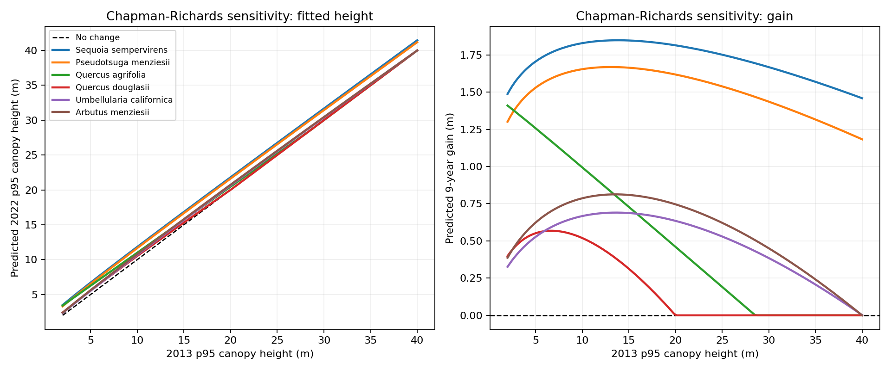

# Growth-curve check, 2013-2022

## Revised fixed-A preflight, 2026-10-15

**G3 fit paused for height-ceiling review.** The revised forest screen has 76,980
cells with the LiDAR-loss filter and 125,888 without it. The PR #13 wire archive
was generated locally; 1,620 cells have a wire-suspect flag and 33,139 lie
within 10 m of a mapped line before the other screens. Nine forest classes have
more than 0.5% of screened 2013 p95 heights at or above their confirmed A.
The rule requires Lakshay to review these values before fitting.

| Forest map class | A (m) | Forest cells | At or above A | Share | Review? |
| --- | ---: | ---: | ---: | ---: | --- |
| Acer macrophyllum | 27 | 171 | 1 | 0.585% | yes |
| Arbutus menziesii | 40 | 4,512 | 5 | 0.111% | no |
| Eucalyptus globulus / camaldulensis | 55 | 342 | 0 | 0% | no |
| Hesperocyparis sargentii | 23 | 982 | 0 | 0% | no |
| Pinus attenuata | 12 | 285 | 103 | 36.140% | yes |
| Pinus sabiniana / Quercus durata | 24 | 492 | 19 | 3.862% | yes |
| Populus fremontii | 34 | 1,433 | 0 | 0% | no |
| Pseudotsuga menziesii | 76 | 3,322 | 0 | 0% | no |
| Mixed six Quercus species | 30 | 10,875 | 30 | 0.276% | no |
| Quercus agrifolia | 25 | 17,265 | 167 | 0.967% | yes |
| Quercus chrysolepis | 30 | 1,111 | 11 | 0.990% | yes |
| Quercus douglasii | 20 | 8,343 | 22 | 0.264% | no |
| Quercus garryana | 30 | 4,597 | 23 | 0.5003% | yes |
| Quercus kelloggii | 25 | 4,464 | 317 | 7.101% | yes |
| Quercus lobata | 25 | 7,437 | 86 | 1.156% | yes |
| Quercus wislizeni (tree) | 23 | 3,036 | 3 | 0.099% | no |
| Sequoia sempervirens | 91 | 1,217 | 0 | 0% | no |
| Umbellularia californica | 24 | 7,096 | 815 | 11.485% | yes |

The full counts and exact fractions are in
`reports/growth_curve_preflight_2013-2022.json`. The fixed-literature-A,
training-fold p99.5-A, free-A and record-tree-A fits have not been run.
The E. camaldulensis Jepson height check remains open; the confirmed mixed
Eucalyptus A of 55 m uses E. globulus until that check is complete.

> Historical pre-revision result (free A; PR #13 wire exclusions unavailable).
> Superseded as a G3 decision pending the fixed-A forest rerun. Do not cite the
> PASS below as the revised gate outcome.

Run: 2026-10-14T08:10:36.292047+00:00. Issue #8. Base revision: 79b64329ec29b9c32fe8fae7720e943614f2632c.

## Gate G3

**PASS** under the predeclared rule: the 95% whole-block bootstrap interval for curve MAE minus no-change MAE must be entirely below zero on 2 km blocks for p95. Delta: -0.263 [-0.306, -0.222] m. The interval uses 2,000 draws with seed 42. Smaller MAE is better.

The 2 km p95 comparison uses 111,672 screened cells in 86 blocks and five folds. The time gap is 8.95825 years.

Against the training-group median, curve MAE differs by -0.003 [-0.011, +0.005] m. Its interval includes zero; a height-dependent advantage is not established.
On forest classes alone (76,980 cells), p95 MAEs are 1.049 m for no change, 0.780 m for the median and 0.781 m for the curve. Curve minus no change: -0.269 [-0.324, -0.219] m; curve minus median: +0.000 [-0.009, +0.011] m.

## Clean-cell screen

The filter retained 111,672 of 1,478,103 unique label cells. Counts overlap; removals are sequential.

| Exclusion, in order | Cells removed at this step | Cells flagged anywhere |
| --- | ---: | ---: |
| overlap disputed | 198 | 198 |
| no 2013 canopy | 759,743 | 759,756 |
| vegetation uncertain | 191,319 | 349,979 |
| hansen nodata | 0 | 0 |
| burned 2013 2022 | 324,280 | 725,575 |
| hansen loss | 1,254 | 182,689 |
| lidar loss | 83,611 | 463,957 |
| near line | 6,026 | 92,155 |

The retained sample is below the prior 200,000-300,000 estimate. The fire rule removes 324,280 additional canopy cells after the earlier exclusions; the large Kincade footprint intersects much of the sampled canopy. No threshold was relaxed to hit the estimate.

FRAP and MTBS records from 2014-2022 include Kincade, Tubbs, Pocket and Walbridge. Hansen loss year 14-22 is an independent Landsat screen. PR #13's optional wire-suspect archive was unavailable; the 30 m CEC line exclusion still applied.

## Held-out comparison

| Block | Target | Cells | Blocks | No change MAE | Median MAE | Curve MAE | Curve - no change [95% block CI] |
| --- | --- | ---: | ---: | ---: | ---: | ---: | --- |
| 2000 m | p95 | 111,672 | 86 | 1.180 | 0.921 | 0.918 | -0.263 [-0.306, -0.222] |
| 2000 m | mean | 111,672 | 86 | 1.375 | 0.867 | 0.853 | -0.522 [-0.591, -0.459] |
| 1000 m | p95 | 111,672 | 225 | 1.180 | 0.919 | 0.917 | -0.263 [-0.300, -0.230] |
| 1000 m | mean | 111,672 | 225 | 1.375 | 0.865 | 0.853 | -0.522 [-0.577, -0.469] |
| 5000 m | p95 | 111,672 | 18 | 1.180 | 0.921 | 0.922 | -0.258 [-0.316, -0.210] |
| 5000 m | mean | 111,672 | 18 | 1.375 | 0.870 | 0.861 | -0.514 [-0.594, -0.440] |

Each 1, 2, or 5 km square block belongs to one fold. Every median increment and curve was fitted on the other four folds. The 95% interval resamples blocks, not individual cells. The main target is 2022 p95 from 2013 p95; mean height is secondary.

## Ecological shape check

| Type | Cells | Gain at 10 m | Gain at 20 m | A bound? |
| --- | ---: | ---: | ---: | --- |
| Quercus agrifolia Alliance | 17,265 | 0.93 m | 0.61 m | no |
| Quercus douglasii Alliance | 8,343 | 0.48 m | 0.29 m | no |
| Umbellularia californica Alliance | 7,096 | 0.58 m | 0.71 m | yes |
| Arbutus menziesii Alliance | 4,512 | 0.77 m | 0.81 m | yes |
| Pseudotsuga menziesii Alliance | 3,322 | 1.54 m | 1.65 m | no |
| Sequoia sempervirens Alliance | 1,217 | 1.94 m | 1.80 m | yes |

At 20 m, fitted gain exceeds or equals gain at 10 m for 3 named types: Umbellularia californica Alliance, Arbutus menziesii Alliance, Pseudotsuga menziesii Alliance. These fits fail the proposed short-tree-faster sense check.
Asymptote A reached the configured upper-bound warning for 12 mapped types: Umbellularia californica Alliance, Quercus garryana Alliance, Arbutus menziesii Alliance, Developed, Quercus kelloggii Alliance, Quercus wislizeni (tree) Alliance, Sequoia sempervirens Alliance, Orchard or Grove, Hesperocyparis sargentii Alliance, Vineyard, Eucalyptus (globulus, camaldulensis) Semi-natural Alliance, Acer macrophyllum Alliance. A bound hit limits biological interpretation.

## Per-type p95 results

A, k, and c are fitted on all clean cells in each displayed scope. MAEs come only from held-out folds. Sparse types pool by broader group.

| Vegetation type | Broad group | Clean cells | Fit scope | A (m) | k (/yr) | c | No change MAE | Median MAE | Curve MAE | Curve - no change [95% CI] |
| --- | --- | ---: | --- | ---: | ---: | ---: | ---: | ---: | ---: | --- |
| Quercus agrifolia Alliance | hardwood forest | 17,265 | type:Quercus agrifolia Alliance | 38.85 | 0.0037 | 1.01 | 1.038 | 0.792 | 0.789 | -0.249 [-0.366, -0.142] |
| Urban Window | other | 17,017 | type:Urban Window | 44.51 | 0.0065 | 10.00 | 1.363 | 1.173 | 1.172 | -0.191 [-0.245, -0.128] |
| Quercus (agrifolia, douglasii, garryana, kelloggii, lobata, wislizenii) Alliance | hardwood forest | 10,875 | type:Quercus (agrifolia, douglasii, garryana, kelloggii, lobata, wislizenii) Alliance | 46.06 | 0.0021 | 1.01 | 0.848 | 0.677 | 0.683 | -0.164 [-0.202, -0.116] |
| Quercus douglasii Alliance | hardwood forest | 8,343 | type:Quercus douglasii Alliance | 34.45 | 0.0023 | 1.01 | 0.512 | 0.331 | 0.330 | -0.182 [-0.234, -0.124] |
| Quercus lobata Alliance | hardwood forest | 7,437 | type:Quercus lobata Alliance | 43.59 | 0.0033 | 1.01 | 1.081 | 0.858 | 0.857 | -0.225 [-0.338, -0.096] |
| Umbellularia californica Alliance | hardwood forest | 7,096 | type:Umbellularia californica Alliance | 120.00 | 0.0015 | 2.50 | 0.978 | 0.788 | 0.802 | -0.176 [-0.243, -0.101] |
| Quercus garryana Alliance | hardwood forest | 4,597 | type:Quercus garryana Alliance | 120.00 | 0.0019 | 10.00 | 0.800 | 0.620 | 0.611 | -0.189 [-0.260, -0.035] |
| Arbutus menziesii Alliance | hardwood forest | 4,512 | type:Arbutus menziesii Alliance | 120.00 | 0.0012 | 1.41 | 1.075 | 0.786 | 0.800 | -0.275 [-0.340, -0.204] |
| Developed | other | 4,474 | type:Developed | 120.00 | 0.0036 | 10.00 | 1.494 | 1.351 | 1.340 | -0.155 [-0.218, -0.088] |
| Quercus kelloggii Alliance | hardwood forest | 4,464 | type:Quercus kelloggii Alliance | 120.00 | 0.0034 | 10.00 | 1.336 | 0.882 | 0.875 | -0.461 [-0.685, -0.214] |
| California Annual and Perennial Grassland Macrogroup | grass | 4,446 | type:California Annual and Perennial Grassland Macrogroup | 43.65 | 0.0038 | 1.01 | 1.422 | 1.124 | 1.115 | -0.308 [-0.387, -0.222] |
| Pseudotsuga menziesii Alliance | conifer forest | 3,322 | type:Pseudotsuga menziesii Alliance | 59.83 | 0.0072 | 3.46 | 1.876 | 1.259 | 1.257 | -0.619 [-0.808, -0.433] |
| Quercus wislizeni (tree) Alliance | hardwood forest | 3,036 | type:Quercus wislizeni (tree) Alliance | 120.00 | 0.0037 | 10.00 | 1.050 | 0.691 | 0.690 | -0.359 [-0.486, -0.284] |
| Populus fremontii Alliance | hardwood forest | 1,433 | type:Populus fremontii Alliance | 33.38 | 0.0108 | 1.01 | 2.152 | 1.452 | 1.415 | -0.737 [-0.876, -0.594] |
| Non-native Forest & Woodland | other | 1,305 | type:Non-native Forest & Woodland | 41.43 | 0.0071 | 1.01 | 2.027 | 1.308 | 1.289 | -0.738 [-0.870, -0.479] |
| Vancouverian Riparian Deciduous Forest Group | other | 1,277 | type:Vancouverian Riparian Deciduous Forest Group | 55.09 | 0.0045 | 1.01 | 1.824 | 1.200 | 1.156 | -0.668 [-0.835, -0.493] |
| Sequoia sempervirens Alliance | conifer forest | 1,217 | type:Sequoia sempervirens Alliance | 120.00 | 0.0021 | 1.04 | 2.280 | 1.667 | 1.719 | -0.561 [-0.792, -0.380] |
| Quercus chrysolepis Alliance | hardwood forest | 1,111 | type:Quercus chrysolepis Alliance | 56.35 | 0.0021 | 1.01 | 0.982 | 0.652 | 0.640 | -0.342 [-0.478, -0.233] |
| Orchard or Grove | other | 1,017 | type:Orchard or Grove | 120.00 | 0.0042 | 10.00 | 1.419 | 1.794 | 1.744 | +0.325 [-0.491, +0.871] |
| Southwestern North American Riparian/Wash Scrub Group | shrub | 1,007 | type:Southwestern North American Riparian/Wash Scrub Group | 28.19 | 0.0165 | 1.90 | 2.289 | 1.524 | 1.526 | -0.763 [-1.047, -0.530] |
| Hesperocyparis sargentii Alliance | conifer forest | 982 | type:Hesperocyparis sargentii Alliance | 120.00 | 0.0033 | 10.00 | 0.747 | 0.892 | 0.856 | +0.110 [-0.190, +0.119] |
| Forest Sliver | other | 877 | type:Forest Sliver | 111.40 | 0.0012 | 1.01 | 1.505 | 1.174 | 1.180 | -0.325 [-0.457, -0.178] |
| Southwestern North American Riparian Evergreen and Deciduous | other | 852 | type:Southwestern North American Riparian Evergreen and Deciduous | 49.02 | 0.0057 | 1.01 | 2.141 | 1.495 | 1.446 | -0.695 [-0.899, -0.467] |
| Vineyard | other | 668 | type:Vineyard | 120.00 | 0.0024 | 10.00 | 1.014 | 1.107 | 0.949 | -0.065 [-0.239, +0.070] |
| Pinus sabiniana / Quercus durata Provisional Alliance | conifer forest | 492 | broad:conifer forest | 71.36 | 0.0064 | 10.00 | 2.096 | 1.275 | 1.251 | -0.845 [-0.982, -0.679] |
| Quercus durata Alliance | shrub | 411 | broad:shrub | 48.80 | 0.0090 | 10.00 | 0.815 | 0.954 | 0.934 | +0.119 [-0.129, +0.568] |
| Eucalyptus (globulus, camaldulensis) Semi-natural Alliance | hardwood forest | 342 | broad:hardwood forest | 120.00 | 0.0008 | 1.01 | 2.276 | 1.912 | 1.894 | -0.382 [-0.510, -0.228] |
| Non-native Shrub | shrub | 339 | broad:shrub | 48.80 | 0.0090 | 10.00 | 1.770 | 1.635 | 1.589 | -0.181 [-0.551, +0.149] |
| Pinus attenuata Alliance | conifer forest | 285 | broad:conifer forest | 71.36 | 0.0064 | 10.00 | 2.361 | 1.606 | 1.639 | -0.722 [-1.062, -0.436] |
| Arctostaphylos (canascens, manzanita, stanfordiana) A. glandulosa Mapping Unit | shrub | 224 | broad:shrub | 48.80 | 0.0090 | 10.00 | 0.697 | 0.834 | 0.903 | +0.206 [-0.078, +0.424] |
| Baccharis pilularis Alliance | shrub | 209 | broad:shrub | 48.80 | 0.0090 | 10.00 | 2.069 | 1.380 | 1.347 | -0.722 [-0.925, -0.542] |
| Acer macrophyllum Alliance | hardwood forest | 171 | broad:hardwood forest | 120.00 | 0.0008 | 1.01 | 1.717 | 1.292 | 1.243 | -0.474 [-0.514, -0.411] |
| Nursery or Ornamental Horticultural Area | other | 89 | broad:other | 58.12 | 0.0055 | 6.95 | 0.548 | 1.262 | 1.117 | +0.570 [+0.498, +0.662] |
| Western North American Freshwater Marsh Macrogroup | grass | 71 | broad:grass | 43.65 | 0.0038 | 1.01 | 2.202 | 1.512 | 1.327 | -0.875 [-0.939, -0.426] |
| Ceanothus cuneatus Alliance | shrub | 70 | broad:shrub | 48.80 | 0.0090 | 10.00 | 2.178 | 1.686 | 1.781 | n/a (one block) |
| Major Roads | other | 70 | broad:other | 58.12 | 0.0055 | 6.95 | 1.132 | 0.905 | 0.955 | -0.177 [-0.364, -0.010] |
| Adenostoma fasciculatum Alliance | shrub | 61 | broad:shrub | 48.80 | 0.0090 | 10.00 | 1.120 | 1.178 | 1.213 | +0.094 [-1.135, +0.308] |
| Quercus wislizeni (shrub) Alliance | shrub | 45 | broad:shrub | 48.80 | 0.0090 | 10.00 | 0.948 | 0.724 | 0.727 | -0.221 [-0.510, +0.168] |
| Barren & Sparsely Vegetated | other | 39 | broad:other | 58.12 | 0.0055 | 6.95 | 1.643 | 1.544 | 1.535 | -0.109 [-0.347, +0.326] |
| Rubus armeniacus Alliance | shrub | 37 | broad:shrub | 48.80 | 0.0090 | 10.00 | 2.055 | 1.430 | 1.412 | -0.643 [-0.810, +0.184] |
| Annual Cropland | other | 30 | broad:other | 58.12 | 0.0055 | 6.95 | 0.490 | 0.818 | 0.914 | +0.424 [-0.723, +0.615] |
| Arctostaphylos viscida Alliance | shrub | 29 | broad:shrub | 48.80 | 0.0090 | 10.00 | 0.819 | 0.899 | 0.937 | +0.118 [+0.062, +0.265] |
| Irrigated Pasture | other | 6 | broad:other | 58.12 | 0.0055 | 6.95 | 2.558 | 1.682 | 1.518 | -1.039 [-1.151, -0.725] |
| Perennial Agriculture | other | 4 | broad:other | 58.12 | 0.0055 | 6.95 | 1.294 | 1.294 | 1.164 | n/a (one block) |
| Toxicodendron diversilobum Alliance | shrub | 4 | broad:shrub | 48.80 | 0.0090 | 10.00 | 0.320 | 1.226 | 1.195 | n/a (one block) |
| Water | other | 4 | broad:other | 58.12 | 0.0055 | 6.95 | 1.871 | 1.854 | 1.733 | -0.138 [-1.110, +0.813] |
| Western North America Vernal Pool Macrogroup | grass | 4 | broad:grass | 43.65 | 0.0038 | 1.01 | 0.329 | 0.659 | 0.790 | n/a (one block) |
| Western North American Freshwater Aquatic Vegetation Macrogroup | other | 4 | broad:other | 58.12 | 0.0055 | 6.95 | 2.911 | 2.504 | 2.528 | -0.383 [-0.858, +1.044] |
| Vineyard Replant | other | 2 | broad:other | 58.12 | 0.0055 | 6.95 | 0.721 | 0.721 | 0.785 | n/a (one block) |

## Source provenance

- [Sonoma 2013 vegetation map](https://socogis.sonomacounty.ca.gov/map/rest/services/OWTSPublic/Sonoma_Veg_Map_Vegetation_and_Habitat/MapServer/0/query) supplies MAP_CLASS.
- [CAL FIRE FRAP](https://services.arcgis.com/V6ZHFr6zdgNZuVG0/ArcGIS/rest/services/California_Fire_Perimeters/FeatureServer/0/query) and [MTBS](https://apps.fs.usda.gov/ArcX/rest/services/EDW/EDW_MTBS_01/MapServer/63/query) supply fire perimeters.
- [Hansen GFC 2024 v1.12](https://storage.googleapis.com/earthenginepartners-hansen/GFC-2024-v1.12/Hansen_GFC-2024-v1.12_lossyear_40N_130W.tif) supplies loss year.
- [CEC transmission lines](https://socogis.sonomacounty.ca.gov/map/rest/services/OWTSPublic/California_Electric_Transmission_Lines/FeatureServer/0/query) supply approximate corridor context.
Raw-file hashes and query settings are in the local provenance files beside the vegetation and clean-cell Parquet outputs.

## Interpretation limits

- Sonoma MAP_CLASS is an alliance or mapping unit, not a pure species assignment. Centers within 5 m of a map boundary were uncertain.
- The screen uses 2022 LiDAR loss_share to define a conditional undisturbed subset. It is never a curve predictor. This score applies to retrospectively screened cells, not to all future cells.
- The prescribed visual audit of persistent forest is outstanding. FRAP can omit small fires or include unburned islands; MTBS omits smaller western fires; Hansen detects stand-replacement loss, not every trim.
- CEC lines are approximate corridor context. PR #13's optional wire-suspect file was unavailable for this run.
- The curve is a candidate ecological baseline. Paper adoption also requires review of the screen, fit bounds and biological shape.

## Reproduction

Run scripts/join_sonoma_veg.py, scripts/build_clean_cells.py, then scripts/run_growth_curve_check.py with the repo environment.

Config: configs/forecasting.yaml. Out-of-fold predictions: data/interim/growth_curve_oof_2013-2022.parquet (local data). Machine metrics: reports/growth_curve_check_2013-2022.json.
